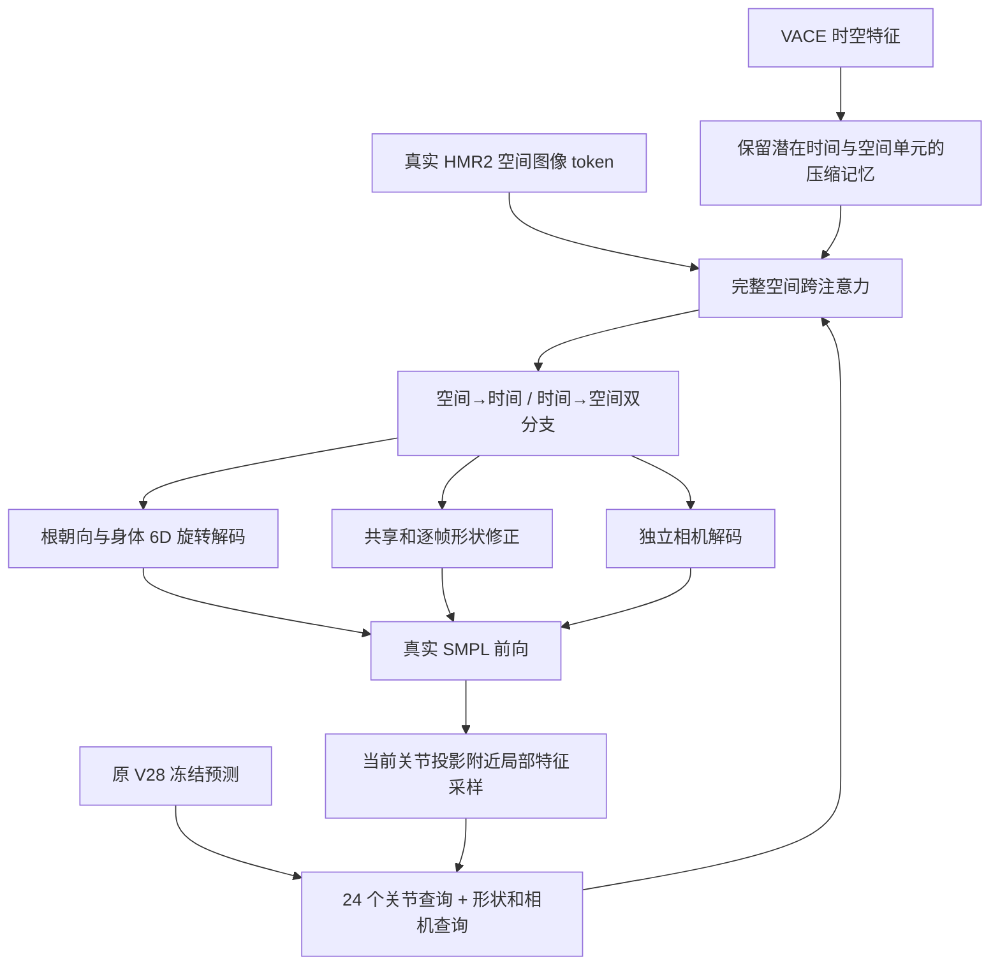

# V30 大幅重构方案与实现状态

日期：2026-10-07。目标首先固定为 **3DPW camera-space SMPL 重建**，主指标 MPJPE、PA-MPJPE、PVE，兼顾连续序列运动误差。世界轨迹性能另建任务，不混入当前排名。

## 一、已知事实和差距

原 V28 完整项目 test：35,515 个有效人帧、24 个序列，MPJPE 68.3920、PA-MPJPE 39.4807、PVE 80.3045 mm。V29Y 同协议分别为 69.0898、39.7860、81.8590 mm，全部退步。V29Y 的 validation 改善没有转化为泛化改善，不能继续宣告成功。

新完成的单种子匹配对照：相同初始化、数据、学习率、运动系数和 6,000 步预算，去掉强全局视觉分支后，validation 为 61.7031/37.9098/73.6943 mm；加回分支为 61.5375/37.9033/73.5444 mm。强分支的增益很小，尚无多种子因果结论；对照未利用 test 选模。

我判断当前需要同时改善**视觉取证方式、可训练姿态空间、运动表示及训练数据覆盖**。这是研究判断，不是已证明的性能保证。

## 二、学习哪些强模型

| 模型与原始来源 | 对我们有用的机制 | 本项目的采用方式 |
|---|---|---|
| [SAM 3D Body 论文](https://arxiv.org/html/2602.15989v1) | 稠密图像特征、查询解码、辅助关节任务；训练数据数量和质量 | V30 保留空间 token；SAM 几何教师先验证 MHR→SMPL，后续再接入真实稠密 DINO 特征 |
| [MotionBERT 论文](https://arxiv.org/abs/2210.06551) | 空间与时间双流关系建模、动作表征预训练 | 实现空间→时间及时间→空间两个分支，学习融合；动作预训练为后续工作 |
| [WHAM 官方项目](https://wham.is.tue.mpg.de/index.html) | 动作信息与视频特征融合、运动数据学习 | 先建立真实时间身份和动作分支；AMASS 只有通过身份/表示审计后才用于预训练 |
| [PyMAF 论文](https://arxiv.org/abs/2103.16507) | 由当前网格投影读取图像局部证据，迭代更新 | 每轮从当前 SMPL 投影附近重新采样 HMR2 空间特征，不把一次全局池化当作局部取证 |
| [GVHMR 论文](https://arxiv.org/html/2409.06662v1) | 序列特征融合、相对时序建模、根运动与身体变量处理 | 借鉴运动/视觉融合与变量分开解码；重力和世界轨迹需要合法相机运动输入，尚未实现 |
| [FactorizedHMR 论文](https://arxiv.org/html/2605.14854v1) | 稳定结构与遮挡歧义分开处理，选择性生成 | 作为后续条件补全路线；当前 V30 是确定性解码，不是该模型的复现 |

这些模型在各自论文协议中取得强结果；MotionBERT 的优势属于其动作下游任务，不能直接转换成我们的网格分数。上述机制组合是新研究实现，不能继承原论文成绩。

论文级强参照：SAM 3D Body DINOv3 在 3DPW 报告 MPJPE/PA-MPJPE/PVE 54.8/33.8/63.6 mm；GVHMR 为 55.6/36.2/67.2 mm。这些数字分别来自上面的原论文表格，尚未同机、同输入协议复现，也不构成完整最新全球排名。我们的 bbox 使用标注派生框，身体表示和加速度单位也必须逐项统一。

## 三、V30 已实现的新结构

- 第一版直接使用现有 **16×12 HMR2 空间 token**，没有冒充重新提取的 SAM 稠密特征。
- 默认隐层 256、8 个 attention heads、4 个双流块；真实帧窗口当前仍是 8 帧。3 轮迭代可配置，16/32 帧需要重新构建数据及检查参考模型接口，尚未实现。
- 冻结 V28 只提供初始预测；新解码头能修正完整旋转，不受此前小角度更新和旧候选插值门控限制。
- 新 6D 旋转增量最后层零初始化，初始输出应与 V28 一致；正交化包括退化输入处理。必须以真实运行确认。
- 根朝向、身体姿态、形状和相机分开输出。形状头同时学习轨迹共享修正及逐帧修正，配合现有一致性监督；不宣称输出已强制成为整段唯一形状。
- 每轮执行真实 SMPL，并在其投影附近采样局部图像证据，结合整张 crop 的图像跨注意力。
- 时间嵌入使用显式 source-frame IDs；缓存无 capture IDs 时使用明确的 annotation 时间身份。重复帧不能作为多个独立时间证据；这不是秒单位速度估计。
- VACE 记忆压缩为每个潜在时刻的 2×3 空间单元，减少密集注意力代价；潜在时间位置与真实源帧时间身份分开处理。
- 原来的 3D joint/vertex/rotation/shape loss 和精确 within/boundary 运动划分仍可复用；模型输入不包含 3D GT。
- 新格式 checkpoint 严格恢复，记录完整参考模型配置。优化器覆盖新模块，参考模型始终冻结。

## 四、训练与扩展路线

### 阶段 A：验证重构本身

1. 对真实 train 帧验证初始化、正交旋转、梯度、优化器覆盖和 checkpoint 恢复。
2. 执行少量真实优化步骤，验证连续窗口及边界损失能够反向传播。
3. 以相同 V28 初始化与完整 train/validation 缓存进行固定预算训练；test 不做在线挑选。
4. 消融：关闭新 temporal、关闭新 local feedback、关闭新 VACE 分支。参考模型自身仍可能含时序/VACE，这些消融仅说明新模块贡献。
5. 先完整运行一个预先登记种子，再按固定计划扩大到三个种子；不能在看到 test 后切换最好种子。

### 阶段 B：改善视觉与教师几何

- MHR 网格到 SMPL 的官方网格映射已下载；独立拟合实验以 RGB 教师预测和原 HMR 预测为输入，GT 仅在拟合后用于训练诊断。
- 固定少量 train 帧通过后扩展到 64 帧，检查转换误差、3D 改善覆盖率、难姿态和分主体结果，再决定是否完整提取 train/validation 教师。
- 稠密 SAM/DINO 特征应保存真实空间结构，显式记录 crop affine；不能使用 HMR crop 的归一化投影直接采样另一个未校准 crop。
- 先比较强教师直接预测、原 V28、新 V30，避免让弱 refiner 把强初始化重新拉回旧候选。
- 真实遮挡/截断必须在 RGB 上执行并重新编码；不把随机 feature dropout 称为真实图像遮挡。

### 阶段 C：动作预训练与更多 3D 数据

- 已审计的 ACCAD 原始 AMASS 只有约 19 万动作帧；旧动作目录分组有演员跨 split，必须使用新的保守演员分组并处理 28 个未识别动作。
- 原 SMPLH 16 betas/52 joints 与当前 SMPL 不等价。先以已通过的 native LBS 得到合法动作几何，再明确关节映射、参数转换和监督对象。
- 动作编码器可从关节序列掩码恢复、速度/骨长一致性学习起步；参数目标只有验证了转换后才能使用。AMASS 不含 RGB，不能直接生成现有 RGB/VACE token。
- BEDLAM、Human3.6M、3DHP 等目前未确认完整可用数据。完成资产与 split 审计后，再配置来源均衡采样，避免仅在 3DPW 小集合上反复拟合。
- 需要额外数据时，渲染 RGB→真实视觉骨干编码，再加入真实图像遮挡及相机变化；这部分尚未实现。

### 阶段 D：处理遮挡歧义

仅在确定性 V30 和强视觉方案有稳定收益后，增加条件 motion prior 或 flow matching。固定可观测结构，补全不可靠肢体；推理只能依据图像观测和学习到的可信度选预测，不能用 GT 选假设。单参考 MPJPE 未必反映多模态质量，需另报遮挡和可信度指标。

## 五、如何判断成功

1. 完整 validation 的 MPJPE、PA-MPJPE、PVE 均下降，加速度不超过已冻结的 V28 validation 上限 22.32907 mm/frame²。
2. 冻结模型、所有训练种子、数据、比较对手和选模规则。此前 test 已被项目观察过，报告必须披露；后续尽可能增加未参与设计的 EMDB/RICH 外部验证。
3. 强模型同机运行，匹配输入框、训练数据、SMPL/MHR/SMPL-X、joint regressor、root/PA/PVE、窗口长度、FlipEval 和单位。
4. 配对完整人物序列做 bootstrap，报告均值、置信区间、多个种子、时延/显存，不靠改变指标口径制造优势。
5. 只在上述证据成立时报告超过指定强基线；超过全部 SOTA 还需要完整、最新、同协议比较。

## 六、本轮代码与状态

- 模型：human_decoder_spatiotemporal_v30.py。
- 数据/前向接口：ram_parts_runtime_v30.py。
- 优化器：parts_training_utils_v30.py。
- 训练入口：train_spatiotemporal_v30_v3.py，步骤引擎 v30_training_engine.py。
- 实际 train 帧检查入口：verify_real_v30_v2.py。
- 来源复制记录：copy_manifest_v2.json；源文件 SHA 在复制前后核对。
- v1 构建器因源 parser 的字符串形式不同而停止，失败的构建器和训练入口保留；v2 完成复制生成。失败入口没有用于服务器训练。

新代码已经上传到原隔离研究目录。真实 8 帧检查通过，以 runs/v30_real_forward_v2_20261007/result.json 为准；4 步真实优化完成，正式两臂固定预算实验继续运行。第 1,000 步已出现满足预设条件的全量 validation 改善；尚无新 test 证据。完整教师几何准备已启动，详见 GEOMETRY_TEACHER_ZH.md 和 STATUS_ZH.md。所有原模型文件保留。**当前尚未超过 SOTA。**
